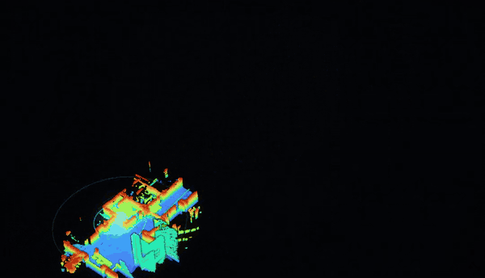

  

  Civil engineering student at IIT Bombay working on physical AI for buildings, construction sites and infrastructure.

 

### Now building

<table>
  <tr>
    <td width="56%" valign="top">
      
    </td>
    <td width="44%" valign="top">
      <a href="https://github.com/VveerMotani/go2-lidar-mapping"><b>go2-lidar-mapping</b></a>
        
      A multi-sensor rig on a quadruped robot that maps buildings in 3D.
        
      A Unitree Go2 carries a LiDAR through a building, and the walk comes back as a 3D map of every floor it visited.
        
      <code>Unitree Go2</code> <code>LiDAR</code> <code>3D mapping</code>
        
      <a href="https://github.com/VveerMotani/go2-lidar-mapping">View the repo →</a>
    </td>
  </tr>
</table>

 

### Selected work

<table>
  <tr>
    <td><a href="https://github.com/VveerMotani/360-construction-progress-monitoring"><b>360-construction-progress-monitoring</b></a></td>
    <td>Finding fire sprinkler pipe in 360° photos of a fit-out site <code>SAM&nbsp;3</code> <code>TensorRT</code></td>
  </tr>
  <tr>
    <td><a href="https://github.com/VveerMotani/construction-progress-monitor"><b>construction-progress-monitor</b></a></td>
    <td>Floor slabs, walls and ceilings found in a raw LiDAR scan of a construction site, measured into a completeness score <code>Open3D</code> <code>RANSAC</code></td>
  </tr>
  <tr>
    <td><a href="https://github.com/VveerMotani/ppe-compliance-detection"><b>ppe-compliance-detection</b></a></td>
    <td>Checks whether workers on a construction site are wearing a helmet and vest <code>YOLOv8</code> <code>OpenCV</code></td>
  </tr>
  <tr>
    <td><a href="https://github.com/VveerMotani/Concrete-Crack-Identifier"><b>Concrete-Crack-Identifier</b></a></td>
    <td>Spots cracks in concrete, and uses Grad-CAM to check the model is looking at the crack <code>PyTorch</code> <code>ResNet-18</code></td>
  </tr>
  <tr>
    <td><a href="https://github.com/VveerMotani/bill-bol"><b>bill-bol</b></a></td>
    <td>Speak a kirana order in any Indian language, get the bill <code>Sarvam&nbsp;AI</code> <code>Voice</code></td>
  </tr>
</table>

 

### Tools

  
  
  
  
  
  
  
  

 

  <b>Open to internships at robotics and physical-AI startups.</b>

  
  
  

  

